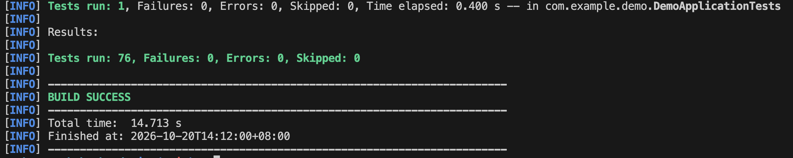
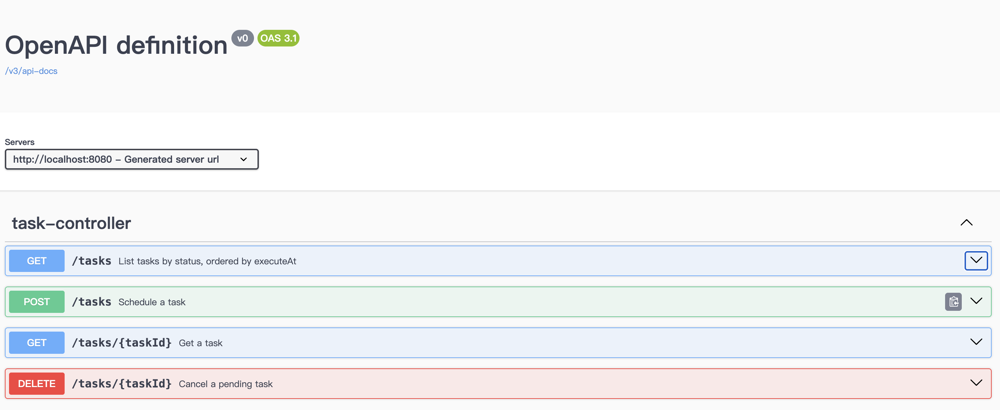
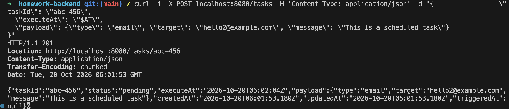
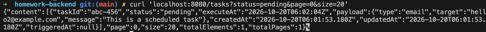
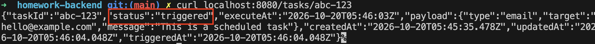
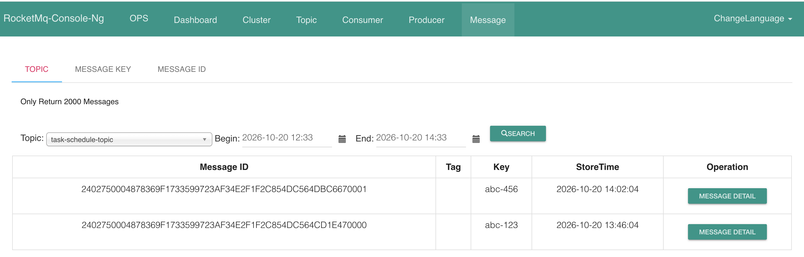
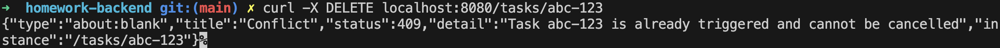
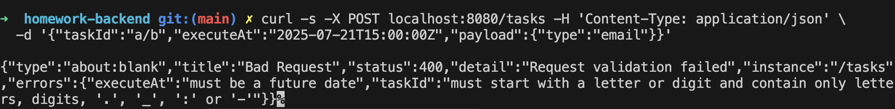

# Task Scheduling Service

A Spring Boot service that schedules tasks and publishes each one to RocketMQ when it is due. MySQL stores the tasks, Redis caches task lookups, and a poller triggers due tasks with at-least-once delivery.

Java 21 · Spring Boot 3.5 · MySQL 8 · Redis 7 · RocketMQ 5 · 76 tests

**Setup, curl samples and configuration: [HELP.md](HELP.md).** The original assignment follows below, unchanged.

```
POST /tasks ──► MySQL (status = PENDING)
                  │
Poller, every second: due PENDING tasks, one transaction each
   lock the row (FOR UPDATE SKIP LOCKED) ─► publish to RocketMQ (key = taskId) ─► mark TRIGGERED ─► commit
                  │
GET /tasks/{taskId} ──► Redis cache ──(miss)──► MySQL
```

## Demo

**All 76 tests pass** (`./mvnw test`)



**The API in Swagger UI**



**Create a task due in 30 seconds:** `201 Created` with its `Location`



**List pending tasks**, paginated



**Once due, the task is triggered**



**The messages in RocketMQ**, keyed by taskId



**Cancelling a task that has already been triggered:** `409 Conflict`



**Invalid requests are rejected** with the failing fields



## Design decisions

### Delivery

- **The task row is the outbox.** `POST /tasks` only writes MySQL, so creating a task never half-succeeds. The poller is the relay: per due task, one transaction locks the `PENDING` row, publishes synchronously, then marks it `TRIGGERED`.
- **At-least-once.** If the app dies after publishing but before committing, the transaction rolls back and the task is published again on the next poll. Nothing is lost, but a message can arrive twice, so consumers deduplicate by `taskId`, which is also the message key.
- **Status changes are conditional updates** (`UPDATE ... WHERE status = 'PENDING'`), so a trigger and a cancel can never both succeed. A cancel that arrives while the task is being published waits for the row lock, then gets `409`. Pollers on several instances skip each other's rows (`SKIP LOCKED`).
- **Failures are handled by kind, not by count.** If the broker is down, the task stays `PENDING` and the next poll retries it, with no limit: a limit would turn a broker restart into a pile of failed tasks. A message that can never be published (e.g. over the broker's size limit) marks its task `FAILED` instead, so it cannot hold up the tasks due after it.

### Redis

- **Cache for single-task reads** (`GET /tasks/{taskId}`, Spring Cache). An indexed MySQL read already takes under a millisecond, so the point is to absorb repeated reads, such as clients polling a task's status. If Redis fails, reads fall back to MySQL.
- **Evicted after the commit.** The caching advice wraps the transaction advice, so a trigger evicts only after it commits; evicting earlier would let a concurrent read cache the old row again. `transactionAware()` also defers evictions, but its after-commit eviction bypasses the cache error handler, so a Redis outage would stall the poller.
- **Known limitation: a stale `pending` can be cached for up to 1 minute.** A read can fetch `PENDING`, the task is triggered and evicted, and only then the read writes `PENDING` back. The 1-minute TTL bounds this.
- **No Redis sorted-set delay queue.** Measured on 1 million rows, the indexed query for due tasks takes 0.26 ms (0.03 ms with `ZRANGEBYSCORE`), while handling each task takes 1.1 ms. A sorted set would speed up about 0.2% of the work and add a second copy of the schedule to keep in sync. It pays off once MySQL load is the bottleneck.

### Future work

- Retry counts with exponential backoff and a dead-letter state, if the downstream becomes endpoints that can fail on their own
- Alert on scheduler lag (how long the oldest due task has been pending), which catches any cause of delay
- Batch locking and a worker pool for higher throughput

---

# 📬 Task Scheduling Service – Backend Homework

This is a technical assignment for backend engineer candidates. You are expected to build a RESTful schedule-task service using **Spring Boot**, integrating **MySQL**, **Redis**, and **RocketMQ**.


---

## 🎯 Objective

Build a RESTful Task Scheduling API that lets users create a task with a specific future execution time.
The system must:
- Store scheduled tasks
- Publish task trigger messages at the specified time
- Allow querying and managing scheduled tasks
- Utilize Redis or in-memory queue as delay buffer (if desired)
- Integrate with RocketMQ for downstream processing

---

## 🧰 Tech Requirements

You **must use** the following technologies:

- **Java 21+**
- **Spring Boot**
- **MySQL** (for persistence)
- **Redis** (for caching)
- **RocketMQ** (for event messaging)

You may use starter dependencies such as:
- Spring Web
- Spring Data JPA
- Spring Cache
- RocketMQ Spring Boot Starter

---

## 🔧 Features to Implement

### 1️⃣ Create Scheduled Task

**Endpoint:** `POST /tasks`

```json
{
  "taskId": "abc-123",
  "executeAt": "2025-07-21T15:00:00Z",
  "payload": {
    "type": "email",
    "target": "hello@example.com",
    "message": "This is a scheduled task!"
  }
}
```

**Expected Behavior:**
- Store the task record in MySQL
- Optionally insert into a Redis delay queue or sorted set
- Ensure the task will be published to RocketMQ (`task-schedule-topic`) when `executeAt` is reached

---

### 2️⃣ Poll & Trigger Task Execution

**Mechanism:**
- A background service should check for due tasks (`executeAt <= now()`)
- Once due, publish the `payload` to MQ
- Mark the task as `triggered` in MySQL

---

### 3️⃣ Get Task by ID

**Endpoint:** `GET /tasks/{taskId}`

**Expected Behavior:**
- Return task details including status, payload, and scheduled time

---

### 4️⃣ Cancel Scheduled Task

**Endpoint:** `DELETE /tasks/{taskId}`

**Expected Behavior:**
- Mark the task as `cancelled` in DB
- Prevent MQ publishing if it hasn’t been triggered

---

### 5️⃣ List Pending Tasks

**Endpoint:** `GET /tasks?status=pending`

**Expected Behavior:**
- Return future scheduled tasks with pagination

⸻

🧪 Bonus (Optional)
- Use Spring Cache abstraction or RedisTemplate encapsulation
- Apply proper error handling with meaningful status codes
- Define your own DTO and message format for RocketMQ
- Use consistent and modular code structure (controller, service, repository, config, etc.)
- Test case coverage: as much as possible

⸻

🐳 Environment Setup

Use the provided docker-compose.yaml file to start required services:

Service	Port  
MySQL	3306  
Redis	6379  
RocketMQ Namesrv	9876  
RocketMQ Broker	10911  
RocketMQ Console	8088  

To start the services:

```commandline
docker-compose up -d
```

MySQL credentials:
- User: taskuser
- Password: taskpass
- Database: taskdb

You may edit init.sql to create required tables automatically.

⸻

🚀 Getting Started

To run the application:

./mvn spring-boot:run

Make sure to update your application.yml with the proper connections for:
- spring.datasource.url
- spring.redis.host
- rocketmq.name-server

⸻

📤 Submission

Please submit a `public Github repository` that includes:
- ✅ Complete and executable source code
- ✅ README.md (this file)
- ✅ Any necessary setup or data scripts please add them in HELP.md
- ✅ Optional: Postman collection or curl samples  

⸻

📌 Notes
- Focus on API correctness, basic error handling, and proper use of each technology
- You may use tools like Vibe Coding / ChatGPT to assist, but please write and understand your own code
- The expected time to complete is around 3 hours

Good luck!

---
